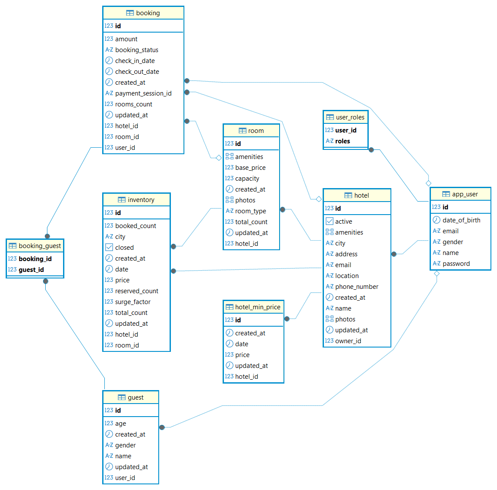
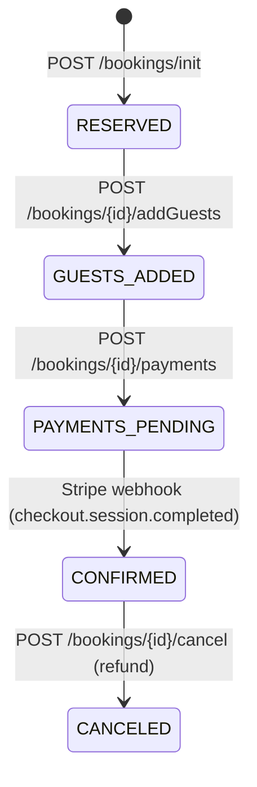

# 🏨 Booking Buddy App

A hotel booking backend system built with **Spring Boot**, **PostgreSQL**, **JWT security** and **Stripe payments**.

Hotel managers create hotels and rooms and control daily inventory. Guests search hotels by city and dates, reserve rooms, add guest details and pay online. Prices adjust automatically with a dynamic pricing engine, and a Stripe webhook confirms the booking after payment.


---
## ER Diagram


---
## ✨ Features

**For guests**
- Sign up and log in with JWT access and refresh tokens
- Search hotels by city, dates and number of rooms (paginated)
- View hotel details with available rooms and average prices
- Book rooms with a multi-step flow: reserve → add guests → pay
- Pay securely through Stripe Checkout
- Cancel a confirmed booking and receive an automatic refund
- Manage saved guests and profile, view booking history

**For hotel managers**
- Create, update, delete and activate hotels
- Create and manage rooms (inventory for the next 1 year is generated automatically)
- Close dates or set a surge factor for any date range
- View all bookings of their hotels and revenue reports

**System**
- Pessimistic locking to prevent double booking
- Dynamic pricing (surge, occupancy, urgency and holiday rules), refreshed hourly
- Stripe webhook with signature verification
- Role-based access control and ownership checks
- Global exception handling and a uniform JSON response format
- Swagger UI for API documentation

---

## 🧰 Tech Stack

| Area | Technology |
|---|---|
| Language | Java 21 |
| Framework | Spring Boot 4.1.1 (Web MVC, Data JPA, Security) |
| Database | PostgreSQL, Hibernate |
| Security | Spring Security, JWT (jjwt 0.12.6), BCrypt |
| Payments | Stripe Java SDK 33.4.2 |
| Mapping | ModelMapper 3.2.6 |
| API docs | springdoc-openapi 2.8.3 (Swagger UI) |
| Other | Lombok, Maven |

---

## 🏗️ Architecture

Layered architecture:

```
Controller  →  Service  →  Repository  →  PostgreSQL
   (REST)      (business     (Spring Data
                 logic)         JPA)
```

### Project structure

```
src/main/java/com/project/booking_buddy
├── advice/        # Global exception handler and response wrapper
├── config/        # ModelMapper and Stripe configuration
├── controller/    # REST controllers
├── dto/           # Request and response objects
├── entity/        # JPA entities and enums
├── exception/     # Custom exceptions
├── repository/    # Spring Data JPA repositories
├── security/      # JWT filter, JWT service, auth service, security config
├── service/       # Business logic (booking, hotel, room, inventory, checkout, ...)
├── strategy/      # Dynamic pricing strategies (decorator pattern)
└── util/          # Helpers
```

### Data model

- **User**: guest or hotel manager
- **Hotel**: belongs to an owner (User), has many Rooms
- **Room**: belongs to a Hotel
- **Inventory**: one row per room per date (`totalCount`, `bookedCount`, `reservedCount`, `price`, `surgeFactor`, `closed`). Unique on `(hotel_id, room_id, date)`
- **Booking**: links a User, Hotel and Room, has many Guests and a Stripe `paymentSessionId`
- **Guest**: people attached to a booking
- **HotelMinPrice**: lowest price per hotel per day, used for fast search results

---

## 🔄 Booking Flow



1. **Init**: availability is checked with a pessimistic lock, rooms are reserved (`reservedCount`), the price is calculated and the booking is saved as `RESERVED`.
2. **Add guests**: guests are attached, status becomes `GUESTS_ADDED`.
3. **Payment**: a Stripe Checkout Session is created, the booking becomes `PAYMENTS_PENDING` and the checkout URL is returned.
4. **Webhook**: after successful payment Stripe calls the backend, the booking becomes `CONFIRMED` and reserved rooms move to booked.
5. **Cancel**: only `CONFIRMED` bookings can be cancelled. Inventory is released and the payment is refunded through Stripe.

A booking must be completed within **10 minutes** of creation.

---

## 💶 Dynamic Pricing

Pricing uses the **Decorator pattern**. Each rule wraps the previous one:

| Rule | Effect |
|---|---|
| Base | Room base price |
| Surge | × `surgeFactor` set by the hotel manager for that date |
| Occupancy | × 1.2 when more than 80% of rooms are booked |
| Urgency | × 1.15 when the date is within the next 7 days |
| Holiday | × 1.25 on listed holidays (currently hard coded) |

A scheduled job (`PricingUpdateService`) runs **every hour** and recalculates inventory prices for the next year and refreshes the `HotelMinPrice` table.